

# Arcadia

**Tous vos jeux PC réunis dans une seule bibliothèque. Belle, rapide, et jouable à la manette.**

### [⬇️ Télécharger Arcadia](https://github.com/dorian86/arcadia-releases/releases/latest/download/Arcadia.exe)

Un seul fichier, rien à installer à côté.

 

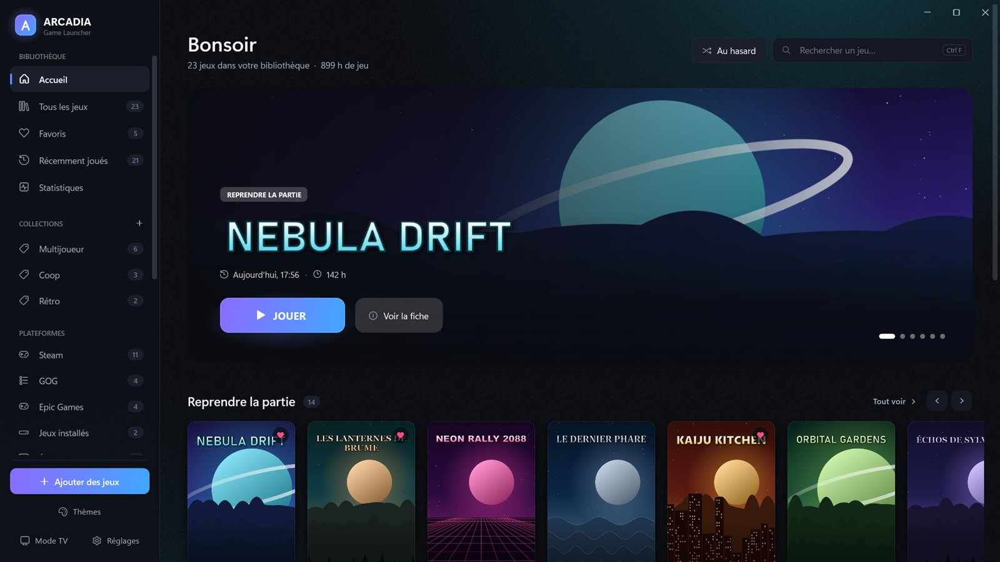

 

## Pourquoi Arcadia ?

Vos jeux sont éparpillés entre Steam, Epic, GOG, Ubisoft, le Xbox Game Pass, des émulateurs et un dossier plein de raccourcis sur le bureau ? Arcadia les rassemble au même endroit :

- 🔍 **Détection automatique** des jeux installés : Steam, Epic Games, GOG, Ubisoft Connect et Xbox / Game Pass. Pour le reste, glissez simplement vos raccourcis ou vos `.exe` dans la fenêtre.
- 🖼️ **Jaquettes, illustrations et logos** trouvés tout seuls, avec le vrai nom de chaque jeu, même à partir d'un raccourci nommé `GTA5.exe - Raccourci`.
- ⏱️ **Temps de jeu**, y compris pour les jeux Steam et Epic, et reprise de votre historique Steam.
- 🎮 **Mode TV** plein écran pour jouer depuis le canapé avec une manette Xbox.
- 🕹️ **Émulateurs** : vos ROM deviennent des jeux comme les autres, avec leur jaquette.
- 🎨 **Thèmes d'interface** dans l'esprit des menus de consoles : Wii, Wii U, Switch, PS3, PS4 et PS5.
- 🔄 **Mises à jour automatiques** en un clic.

 

## Aperçu

<table>
  <tr>
    <td width="50%">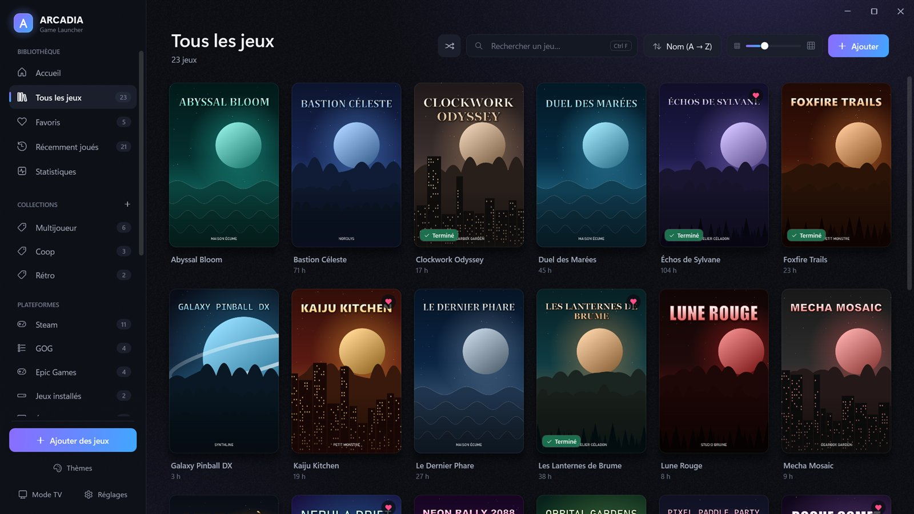
<b>Bibliothèque</b> Recherche, tri, favoris, collections, plateformes
</td>
    <td width="50%">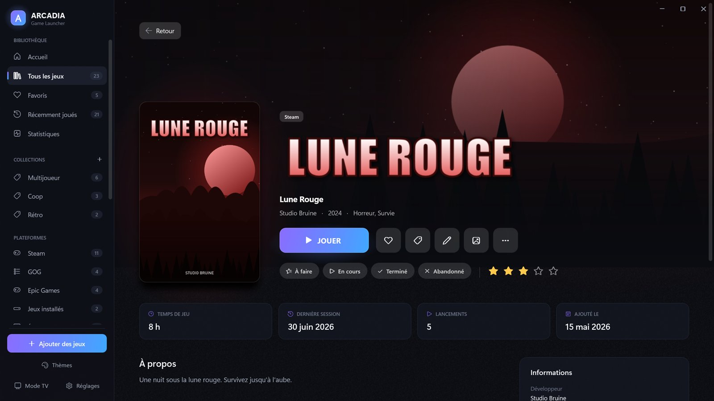
<b>Fiche du jeu</b> Temps de jeu, statut, note sur 5, notes personnelles
</td>
  </tr>
  <tr>
    <td width="50%">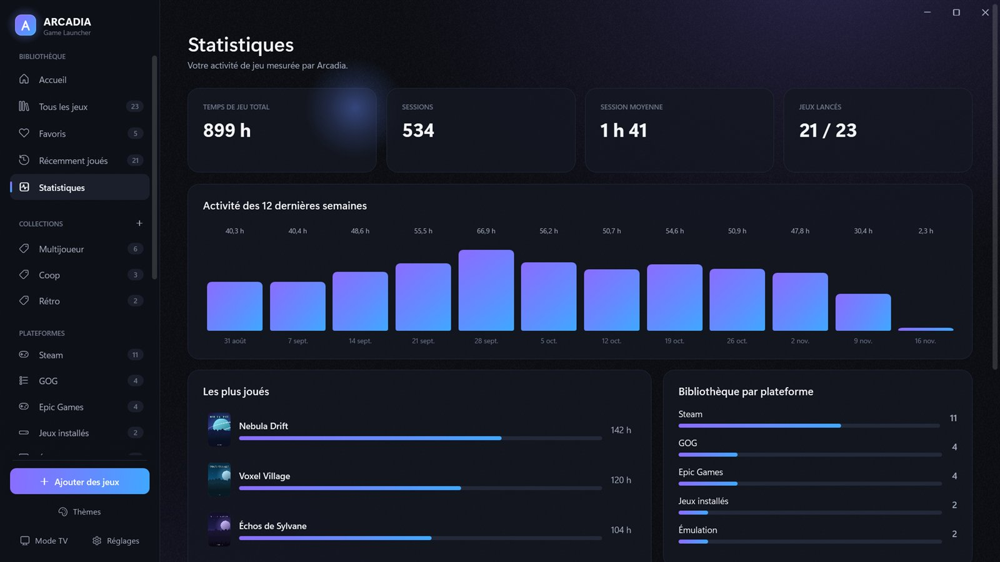
<b>Statistiques</b> Activité semaine par semaine, jeux les plus joués
</td>
    <td width="50%">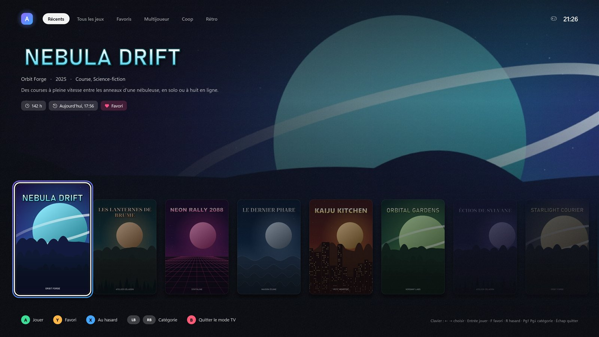
<b>Mode TV</b> Plein écran, pensé pour la manette
</td>
  </tr>
</table>

 

## Thèmes d'interface

Changez complètement le look d'Arcadia depuis le menu **Thèmes**. Clavier, souris et manette fonctionnent dans tous les thèmes.

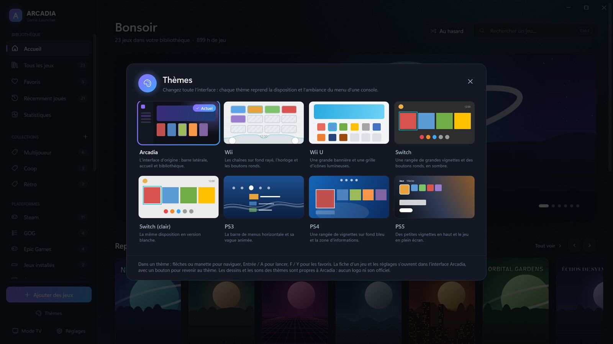

<table>
  <tr>
    <td width="50%">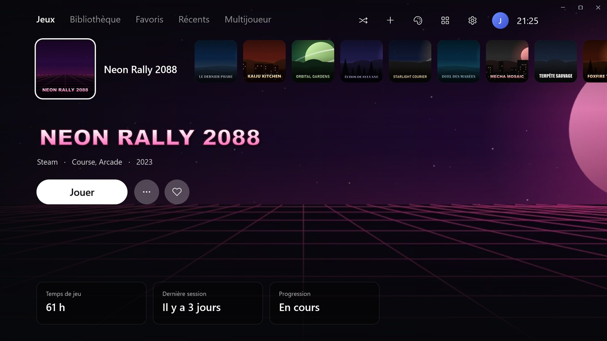
<b>PS5</b>
</td>
    <td width="50%">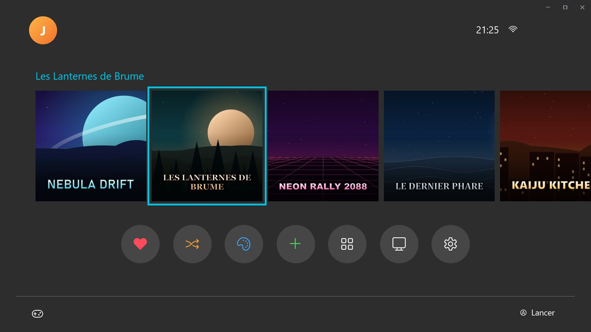
<b>Switch</b> (sombre ou clair)
</td>
  </tr>
  <tr>
    <td width="50%">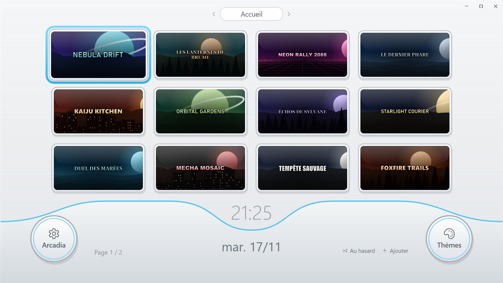
<b>Wii</b>
</td>
    <td width="50%">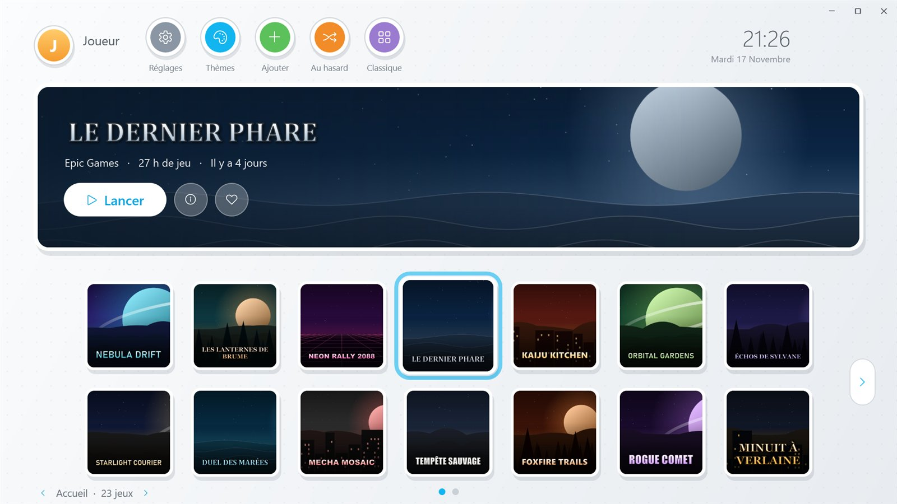
<b>Wii U</b>
</td>
  </tr>
  <tr>
    <td width="50%">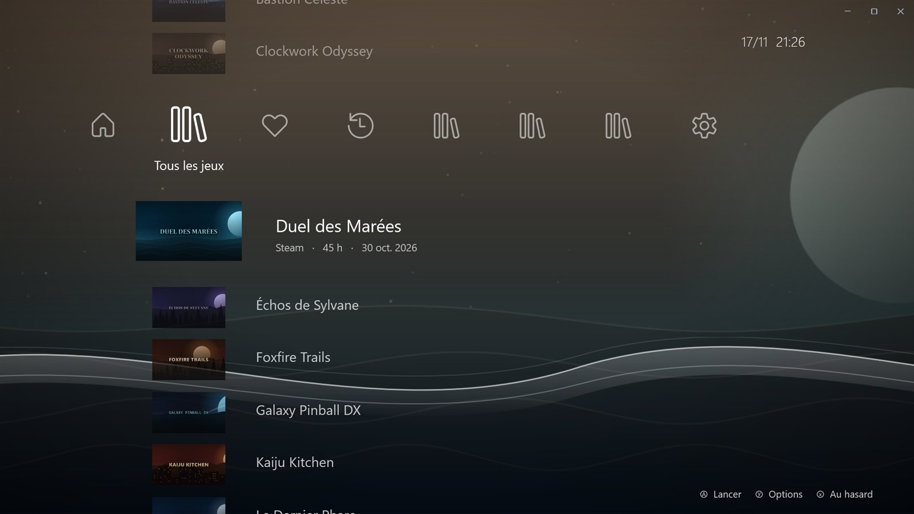
<b>PS3</b>
</td>
    <td width="50%">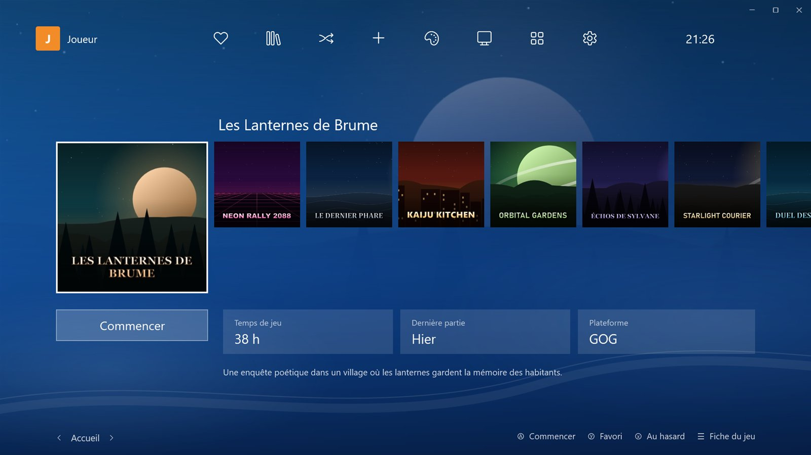
<b>PS4</b>
</td>
  </tr>
</table>

 

## Installation

1. **[Téléchargez `Arcadia.exe`](https://github.com/dorian86/arcadia-releases/releases/latest/download/Arcadia.exe)** et lancez-le. Aucune installation de .NET ni d'autre logiciel n'est nécessaire.
2. Au premier lancement, Windows peut afficher **« Windows a protégé votre ordinateur »**, parce que le programme n'est pas signé par un éditeur payant. Cliquez sur **Informations complémentaires**, puis **Exécuter quand même**.
3. Cliquez sur **Ajouter des jeux → Détecter les jeux installés**, ou glissez vos raccourcis de jeux dans la fenêtre.

> **Astuce :** *Réglages → Système → Installer* copie Arcadia dans vos programmes, ajoute un raccourci dans le menu Démarrer et une entrée dans « Applications installées » pour le désinstaller proprement.

## Mises à jour

Arcadia vérifie au démarrage s'il existe une nouvelle version et vous propose de l'installer en un clic, avec la liste des nouveautés. Il se met à jour et redémarre tout seul. Vous pouvez aussi vérifier à la main dans *Réglages → Mises à jour*.

## Questions fréquentes

<b>Arcadia touche-t-il à mes jeux ?</b>

 
Non. Arcadia ne modifie, ne déplace et ne supprime jamais les fichiers de vos jeux. Il garde seulement un lien vers chacun.

<b>Où sont mes données ?</b>

 
Tout reste sur votre PC, dans <code>%APPDATA%\Arcadia</code> : la liste de vos jeux, les jaquettes en cache et vos réglages. Copiez ce dossier pour sauvegarder votre bibliothèque ou la transférer sur un autre PC. Les mises à jour n'y touchent pas.

<b>Il me faut un compte ?</b>

 
Non. Arcadia fonctionne sans compte et même hors ligne. Internet sert seulement à trouver les jaquettes et à vérifier les mises à jour.

<b>Quelle manette est compatible ?</b>

 
Les manettes Xbox et toutes celles compatibles XInput. Start + Back ouvre le mode TV.

<b>Comment désinstaller ?</b>

 
Si vous avez utilisé <i>Installer</i> : <i>Paramètres Windows → Applications → Arcadia → Désinstaller</i>. Sinon, supprimez simplement <code>Arcadia.exe</code>, et le dossier <code>%APPDATA%\Arcadia</code> si vous voulez effacer votre bibliothèque.

 

---

Les captures montrent une bibliothèque de démonstration avec des jeux fictifs dessinés par Arcadia. Les thèmes reprennent la disposition et l'ambiance de menus de consoles avec des dessins et des sons propres à Arcadia : aucun logo, police, musique ni son officiel. Wii, Wii U et Switch sont des marques de Nintendo ; PlayStation, PS3, PS4 et PS5 sont des marques de Sony Interactive Entertainment. Arcadia n'est affilié à aucune de ces sociétés.
